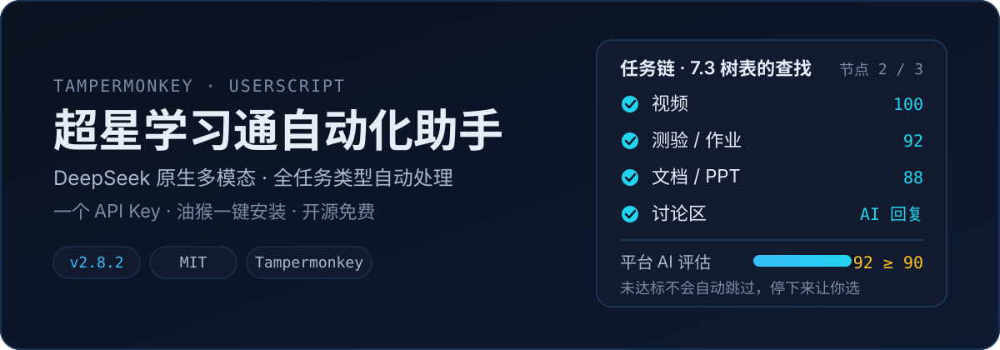
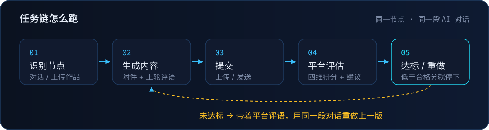

<p align="center">
  
</p>

<p align="center">
  <a href="https://github.com/Khihl-lucky/ChaoXing-AutoAnswer/releases"></a>
  <a href="LICENSE"></a>
  <a href="https://www.tampermonkey.net/"></a>
  <a href="https://platform.deepseek.com"></a>
</p>

**一个 DeepSeek API Key，把学习通的视频、测验、文档、讨论区和 AI 实践任务链全部跑完。**
脚本开源免费，密钥自己填，不经过任何第三方服务器。

## 它做什么

- **全任务类型接管**：视频/音频自动播放与倍速、测验与作业 AI 作答、文档/PPT 模拟翻阅、阅读任务、直播回放、速课、讨论区自动回复、考试整卷预览答题。
- **AI 实践任务链**：自动识别节点，情景对话逐轮作答；上传作品节点会读题目附件、生成 docx/源码、校验上传记录，再按平台 AI 评估的不足与建议重做。
- **原生多模态**：纯文本题走 `deepseek-flash`，图片题自动截图识别；也可切到 `deepseek-v4-pro` 做强推理，图片仍交给 `deepseek-flash`。
- **不静默跳过**：未达合格分、附件读取失败、上传未落库、评估读不到，都会停下来告诉你，而不是假装完成。

## 快速开始

### 1. 安装油猴

前往 [Tampermonkey 官网](https://www.tampermonkey.net/) 安装浏览器扩展。

### 2. 安装脚本

**[➡️ 安装 chaoxing-autoanswer.user.js](https://raw.githubusercontent.com/Khihl-lucky/ChaoXing-AutoAnswer/main/chaoxing-autoanswer.user.js)**

国内网络打不开 `raw.githubusercontent.com` 时，用镜像安装：

`https://ghproxy.net/https://raw.githubusercontent.com/Khihl-lucky/ChaoXing-AutoAnswer/main/chaoxing-autoanswer.user.js`

> 脚本头部带 `@downloadURL` / `@updateURL`，装一次之后由油猴自动检查更新。

### 3. 填 API Key

打开任意学习通页面 → 脚本浮窗 → **设置** → 填入 DeepSeek API Key（[platform.deepseek.com](https://platform.deepseek.com) 获取）。文本题与图片题共用这一个 Key。

### 4. 开始使用

打开课程页面，脚本会自动检测任务点并开始处理；日志实时显示在浮窗里。卡住时可点浮窗里的 **跳过任务**。

## 任务链怎么跑

<p align="center">
  
</p>

1. **识别节点**：从任务链页面读取节点列表与状态，按顺序推进，不预设节点总数。
2. **生成内容**：读取题目附件（代码、样例、pptx 等），连同**上一轮平台评语**一起交给模型。
3. **提交并校验**：生成 docx 或源码后上传；弹窗关闭不等于成功，会再核对平台是否真的记录了文件。
4. **读平台评估**：只认平台自己的 AI 评分（四维得分 + 不足 + 建议），按作答次数取最新一次。
5. **未达标重做**：沿用**同一段对话**，把上一版输出与新一轮评语一起发回去改；合格分在设置里可调。

## 功能一览

| 任务类型 | 处理方式 |
|---|---|
| 视频 / 音频 | 自动播放、倍速、静音；人脸识别弹窗检测；完成状态轮询 |
| 测验 / 作业 | AI 搜题作答；精确匹配 → Levenshtein 模糊 → 字母回退；提交前校验未作答 |
| 文档 / PPT / 阅读 | 递归 iframe 逐屏滚动，触底提交；45s 超时与跨域降级 |
| 读书 / 速课 / 直播 | 调用对应任务接口，进度上报 |
| 讨论区 | AI 自动回复（弹窗内跨域读取上下文） |
| 考试 | 整卷预览模式自动答题，不自动交卷 |
| AI 实践任务链 | 对话节点与上传作品节点自动完成，按平台评分迭代 |

## 配置

### DeepSeek

| 参数 | 说明 | 默认值 |
|---|---|---|
| API 密钥 | `sk-` 开头的 DeepSeek 密钥 | — |
| API 地址 | DeepSeek 端点或兼容中转地址 | `https://api.deepseek.com` |
| 文本模型 | `deepseek-flash`（快、支持图片）/ `deepseek-v4-pro`（强推理、纯文本） | `deepseek-flash` |
| 图片题处理 | `自动路由` / `总是用多模态` / `只用文本模型` | `自动路由` |

<details>
<summary>模型与图片细节（官方信息）</summary>

| 模型名 | Context | Vision | 脚本用途 |
|---|---:|---|---|
| `deepseek-flash` | 1M | ✅ | 文本与图片默认模型 |
| `deepseek-v4-pro` | 1M | ❌ | 可选纯文本强推理，图片题仍转交 `deepseek-flash` |

- 图片以 base64 `data:image/png` 内联在 `user` 消息中，`detail: "high"`；单张上限 32 MiB，请求体上限 48 MiB。
- 旧的 `deepseek-v4-flash` / `-vision-exp` 已被官方退役，脚本已将其视为支持视觉，便于第三方中转兼容。

</details>

### 视频 / 答题 / 测验

| 参数 | 说明 | 默认值 |
|---|---|---|
| 播放倍速 | 视频/音频速度，平台禁用倍速时自动回退 1× | `1×` |
| 复习模式 | 补挂视频时长，不跳过已完成视频 | 关闭 |
| 搜题间隔 | 两次 AI 请求之间的最小间隔（秒） | `0` |
| 好学生模式 | 只加粗答案，不自动选择 | 关闭 |
| 相似度匹配 | Levenshtein 模糊匹配答案 | 开启 |
| 测验自动提交 | 答题完成后自动提交；有未作答题目时会停住 | 关闭 |
| 强制提交 | 忽略未作答校验强制提交 | 关闭 |

### AI 实践 · 任务链

| 参数 | 说明 | 默认值 |
|---|---|---|
| 自动开始 | 进入任务链页面后自动执行 | 开启 |
| 合格分 | 低于该分数视为未通过并重做（可按页面解锁条件自动跟随） | `61` |
| 最大重试 | 低分节点重试次数 | `2` |
| 对话轮数 | 每个情景对话节点作答轮数 | `20` |
| 生成后直接上传 | 跳过预览直接提交 | 关闭 |
| 输出上限 | 单轮输出 token，`0` 表示交给服务端决定 | `0` |

## 技术亮点

- **原生多模态分流**：一个 Key，文本走文本模型，图片自动转视觉模型，避免接口 400。
- **三级答案匹配**：精确匹配 → Levenshtein 编辑距离 → 字母回退。
- **字体解密**：内置 Typr.js + MD5，还原超星 `font-cxsecret` 混淆字体。
- **跨 iframe 递归**：深层 iframe 逐屏滚动模拟，文档触底自动提交。
- **任务跳过**：`postMessage` 跨窗口通信，父窗口一键跳过卡死任务。
- **DOM 状态同步**：手动标记 `ans-job-finished`，刷新前即可判定任务点完成。
- **开发者调试**：浮窗内查看每次真实发送给 AI 的请求、平台评估原文与本地缓存，支持导出 JSON（密钥打码）。

## 常见问题

<details>
<summary>文档 / PPT 任务卡住了怎么办？</summary>

点浮窗里的 **跳过任务**，脚本会跳过当前任务点并继续往下走。
</details>

<details>
<summary>API 请求失败？</summary>

看日志里的错误信息：常见原因是 Key 无效、余额不足或代理不通。检查 API 地址与系统时间。
</details>

<details>
<summary>图片题识别不出来？</summary>

确认「图片题处理」不是「只用文本模型」，多模态模型填 `deepseek-flash`（`deepseek-v4-pro` 不支持图片）。报 400 时脚本会自动改走多模态模型并在日志里警告。
</details>

<details>
<summary>视频没有倍速？</summary>

部分课程禁用了倍速菜单，脚本会回退到 1×，避免进度被平台清零。
</details>

<details>
<summary>考试会自动交卷吗？</summary>

不会。整卷预览模式答完题后由你核对并手动交卷；提交前脚本会提示还有哪些题没作答。
</details>

<details>
<summary>从旧版本升级要改配置吗？</summary>

不用。旧的 Kimi 配置已移除，只保留 DeepSeek Key 即可，图片题自动交给 `deepseek-flash`。
</details>

## 更新日志

**v2.8.2** — 修复阅读理解/完形填空复合题被整块跳过（父题展开为子题、DOM 优先判题型）；提交前校验未作答题目，不再带着空题自动提交。

**v2.8.1** — 修复含 PPT 的章节误报「未完成任务点」：容器与附件按序对齐，完成标记打到 `.ans-attach-ct`，已完成任务补标记。

**v2.8.0** — 任务链重做沿用同一段 AI 对话；评估按作答次数取最新；上传/评估双校验；新增开发者调试面板；附件以 Markdown 原文注入。

完整历史（v2.7.0 及更早）见 [CHANGELOG.md](CHANGELOG.md)。

## 项目结构

```text
学习通脚本/
├── chaoxing-autoanswer.user.js   # 主脚本（约 1.1 万行，油猴直接安装）
├── assets/readme/                # README 用 SVG（hero / 流程图）
├── CHANGELOG.md                  # 完整更新历史
└── README.md
```

## 开发

直接编辑 `chaoxing-autoanswer.user.js`，在 Tampermonkey 里加载本地文件即可调试；没有构建步骤。改动后至少跑一次脚本头部的版本号与 `NE21_BUILD` 更新，便于定位问题版本。

## 免责声明

本项目仅用于学习与研究目的，包括脚本调试、前端自动化研究和页面行为分析。使用者应遵守目标平台的使用规定，不得将本项目用于违反相关服务条款的行为。因不当使用产生的一切后果由使用者自行承担，项目作者不对此负责。

## 致谢

- 原作者 [Ne-21](https://scriptcat.org/en/users/227) — 脚本基础架构
- [DeepSeek](https://www.deepseek.com/) — 文本推理与原生多模态视觉模型
- DeepSeek Harness — AI 辅助开发

## 参考资料

- [DeepSeek 模型与定价](https://api-docs.deepseek.com/zh-cn/quick_start/pricing)
- [DeepSeek Vision 图片输入指南](https://api-docs.deepseek.com/zh-cn/guides/vision)

## 许可证

MIT © [Khihl-lucky](https://github.com/Khihl-lucky)
